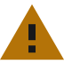
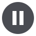

# knobs brand

How knobs presents itself: the logo, colour, type, shapes, motion, icons and words. These rules hold wherever knobs appears: the app, getknobs.app, the README, release notes, videos, and anything else that shows knobs to someone.

Everything they govern is in this repository. The logo is in `logo/` and `web/`, the fonts are in `fonts/`, and every value below is in `tokens/tokens.json`, with copies for CSS and C++ in `dist/`. If a value here and `tokens.json` ever disagree, `tokens.json` is right.

## The idea

A knob turned to its top position, with the level it has swept through. Below it or beside it, the name, with "obs" in red. Everything is cut straight: the pointer, the ends of the sweep and the tops of the k and b. Nothing is rounded except the circles themselves.

The rest of the brand follows the logo. Corners are square, and round things are true circles. Angles are 45°, the pointer's angle. Red, the red of the caps on studio knobs, always means knobs. The words are plain.

## Logo

- **Horizontal lockup:** the default, everywhere there is room for it.
- **Stacked lockup:** only where the space is close to square, or taller than it is wide.
- **Mark alone:** app and tray icons, favicons, and any place the lockup would be under 24px tall.
- **Versions:** "light" (light ink, for dark grounds), "dark" (dark ink, for light grounds), and one-colour "white" and "black".
- Always use the files. Never retype the wordmark or redraw the mark.

### The mark

Drawn on a 100-unit square, centred at 50, 50.

- **Knob:** a disc of radius 34.5, in the ink.
- **Pointer:** a V-cut pointing to 1:30 (45° up and right), 17 units wide at the rim, its tip 2 units from the centre.
- **Sweep:** starts at 7:30, the knob's lowest position, and runs clockwise to the pointer. It grows evenly from 3.5 units wide to 9. Both ends are cut square, and the last continues the pointer's leading edge.
- **Gap:** 4.5 units between the knob and the sweep. The sweep's outer edge reaches radius 48.
- **Colour:** the knob in the ink, the sweep in cap red, the same red as "obs".

### The wordmark

- Set in Schibsted Grotesk (SIL Open Font License), then redrawn and outlined. The font isn't shipped and isn't needed.
- "kn" in Medium 500, "obs" in SemiBold 600: one weight step, so all five letters share one design.
- The k and b ascenders are shortened and cut at 45°, the angle of the pointer. The b is lifted 1.2 units, on a 60-unit x-height, so the two cuts line up.
- The font's own kerning, tightened by 1.3 units per pair.
- Always lowercase, including at the start of a sentence.
- "obs" takes cap red in the colour logo and the ink in one-colour versions. The weight step keeps the split readable either way.

### Clear space and minimum size

- Keep a quarter of the mark's height clear on every side of any lockup or of the mark. Nothing else enters it, including the edge of the screen or page.
- Icons give way: the favicon and the Windows app's and tray's icons fill their square, as Windows' own icons do.
- Lockup: at least 24px tall on screen, 8mm in print. The site's header uses it at 32px tall (140px wide).
- Mark: at least 16px, 5mm.

### Grounds

- The colour logo goes on graphite, near-black, white or a pale grey only.
- On the footer's red band, photos, other colours, mid-tones or anything busy, use the white or black version.
- Never put the colour logo on cap red, and never put cap red on the ink.

### Don't

- Stretch, squash or rotate it, or turn the knob to another position.
- Recolour the red, swap the ink and the red, or give the sweep and "obs" different colours.
- Use the colour logo on mid-tones or busy grounds.
- Add shadows, glows, gradients, outlines or bevels.
- Retype the wordmark, change its spacing, or set it in capitals.
- Put the mark inside a circle, badge or any other container, apart from the icon tiles below.

### App icon and favicon

- The light mark on a graphite tile, at 3.2× on a 512 tile. The mark is centred by eye, not by its box: the point 47.6, 46 on the 100-unit grid sits at the tile's centre, about halfway between centring the knob and centring the whole mark.
- The rounded tile (radius 112 on 512) is the app icon. The square tile is for iOS, which rounds it itself.
- The favicon is the mark alone, filling its square: one SVG holding both marks, the dark one on light browser tabs and the light one on dark tabs, switching with the system's light or dark setting.
- `favicon.ico` (16, 32 and 48) and the favicon PNGs keep the tile, at 64 units (radius 14) with the mark at 52%, for browsers that can't switch an SVG favicon: one picture that reads on any tab.
- The iPhone icon keeps its square tile, since iOS fills transparency with black.
- The Windows app's icon is the mark alone, with no tile. A plain `.exe` icon is one picture for light and dark taskbars alike, and the `.exe`'s, which Explorer, Start and the installer show, is the dark mark: the graphite dial with the red sweep, for the light grounds those mostly are. Where the app picks its icon itself, in its windows and its notifications, a dark ground gets the light mark, the white dial.
- The tray uses the one-colour mark with no tile, as Windows' own tray icons are: white on a dark taskbar and black on a light one, switching when Windows' mode does.
- At 16 and 20px the tray's mark is the knob alone, filling its square. There the gap and the sweep's start are under a pixel, and anti-aliasing smears them into grey. From 24px the sweep is back. The knob-alone files are the one-colour `knobs-knob-white.svg` and `knobs-knob-black.svg`, on the mark's 100-unit grid.

### Share card

1200 × 630, graphite, the light horizontal lockup centred at 620px wide. Nothing else on it.

### Files

- `logo/svg/`: `knobs-lockup-horizontal-*`, `knobs-lockup-stacked-*`, `knobs-mark-*` and `knobs-wordmark-*` in light, dark, white and black; `knobs-knob-white.svg` and `knobs-knob-black.svg`, the knob alone for the tray's smallest sizes; `knobs-app-icon.svg` (the rounded tile) and `knobs-app-icon-square.svg`.
- `logo/png/`: horizontal lockups at 1200 and 2400 wide, stacked lockups at 1200, the mark at 1024, and the app icon at 256, 512 and 1024.
- `web/`: `favicon.svg` (the mark alone, switching with light and dark), `favicon.ico`, `favicon-16.png`, `favicon-32.png` and `favicon-48.png` (on the tile); `apple-touch-icon.png` (180, square); `icon-192.png` and `icon-512.png` (the rounded tile, for a web app manifest); `card.png`, the share card.

Every SVG is outlined and needs no fonts. The files carry no metadata: the SVGs hold their artwork and a title, and the rasters their pixels.

## Colour

Graphite leads, and red means knobs. A near-neutral graphite carries the brand in two schemes: graphite grounds in the dark scheme, a cool pale grey desk with white panels in the light one. One red, cap red, marks everything that is knobs and everything that can be pressed. Cap red deep, the red of the light scheme's buttons, is also the band the page closes on, in both schemes.

The palette is derived in OKLCH. Every neutral sits on graphite's hue (260), and every red on cap red's (21 to 27).

### The brand colours

| Name | Value | OKLCH | Role |
| --- | --- | --- | --- |
| Graphite | `#191b1d` | 0.22 0.006 260 | The brand ground: the dark scheme's page, the app icon's tile, the share card. The logo's ink on light grounds, and text in the light scheme. |
| Ink | `#e5ecf6` | 0.94 0.016 260 | The logo's ink on dark grounds, and text in the dark scheme. |
| Cap red | `#df695e` | 0.66 0.15 27.3 | The colour of knobs on dark grounds: the sweep and "obs", and the action colour. |
| Cap red deep | `#c55149` | 0.585 0.15 26.7 | Cap red on white and light grounds, and the footer band in both schemes. |
| White | `#ffffff` | 1 0 0 | Panels in the light scheme, words on red, and the one-colour logo. |
| Black | `#000000` | 0 0 0 | The one-colour logo on light colours and photos. |

### Where red goes

Cap red is the colour of knobs. It marks two things, and nothing else.

- **What can be pressed.** Every way to get knobs is a solid red button. Secondary buttons are red outlines with red words, and fill red under the pointer. A link keeps the colour of the words around it and sits on a red underline; under the pointer its words turn red too. The underline, not the colour, says it's a link. Focus is a 2px red ring. Selected text takes a red wash, and the text caret is red.
- **What is knobs.** The sweep and "obs" in the logo. knobs's bars in a chart, lit, beside OBS's unlit grey. knobs's stage in a drawing of the mic's path, where each filter's fader runs up to its setting in red as the signal passes through it. The main file in a list of downloads, and the download step. The cap dots that mark the items of a list.

Red never means an error or a warning. A problem is said in words, in the text colours; only the buttons that fix it are red, because every button is. A pre-release tag stays grey.

Cap red stays under a tenth of any surface. It is everywhere knobs is, and never a wall, apart from one band: the footer, below. Grounds, headlines, body text and lines stay neutral, so the red has something to stand out against.

Words on cap red are graphite, never ink: cap red on ink is 2.8:1. Words on cap red deep are white. In the light scheme, red words take a deeper shade, `#ab3a34`, because cap red deep is only 3.6:1 on the deeper grey.

### The footer band

The page ends on a band of cap red deep, the same in both schemes: the page's one large field of red, and a red it already uses for the light scheme's buttons.

- **On the band:** the white one-colour lockup, never the colour logo. Every word, link and underline is white, 4.5:1 with no margin, so small words (the legal lines) take weight 500. A link's underline thickens under the pointer. Hairlines and control edges are lighter shades of the band's red; selected text sits on a deeper one, and the focus ring is white.
- **One field.** The band is the footer and nothing else. Red elsewhere stays edges, fills of controls, dots and bars.

### The dark scheme

Graphite grounds, ink text, and cap red for what is knobs and what can be pressed. Contrast is WCAG 2, against the grounds named.

| Role | Value | Use | Contrast |
| --- | --- | --- | --- |
| `ground` | `#191b1d` | The page, graphite. Sections alternate between it and `ground-deep`. | |
| `ground-deep` | `#0c0e10` | A band a step below the ground, deep enough to show on a dim screen. | |
| `raised` | `#202225` | A panel or a row on the ground. | |
| `raised-2` | `#25282c` | A raised panel under the pointer, or a pressed control. | |
| `sunken` | `#131518` | A well: code, checksums, the filter chain. | |
| `screen` | `#131518` | The frame of a video or a screenshot, like a screen that's off. | |
| `line` | `#2d2f33` | Hairlines: rules, dividers, wires, gridlines. | |
| `line-strong` | `#3e4146` | Control edges and titled rules. | |
| `text` | `#e5ecf6` | Headlines, body text and names, in ink. | 14.5 on ground, 16.3 on ground-deep, 13.4 on raised, 15.4 on sunken |
| `text-2` | `#b9bec7` | Secondary text: the lede, notes, links in a list. | 9.3, 10.4, 8.5 |
| `text-3` | `#90969e` | Labels, captions and the legal lines; idle icons and wires. | 5.8, 6.5, 5.3, 6.1 |
| `action` | `#df695e` | Cap red: solid buttons, outlined buttons' edges, the main file's edge, the download step. | 5.2 on ground, 5.8 on ground-deep, 4.8 on raised |
| `action-hover` | `#e8796d` | A solid button under the pointer, lit a step. | |
| `action-text` | `#df695e` | Red words: an outlined button's label, a hovered link. | as `action` |
| `on-action` | `#191b1d` | Words and icons on a solid red button: graphite, never ink. | 5.2 on action, 6.1 on action-hover |
| `link-underline` | `#df695e` | A link's underline. | |
| `link-hover` | `#df695e` | A link's words under the pointer. | |
| `focus` | `#df695e` | The focus ring. | 4.8 or more on every ground |
| `selection` | `#7a342e` | Selected text's ground, under ink. | ink on it 7.5 |
| `band` | `#c55149` | Cap red deep: the footer band, the same in both schemes. | |
| `band-line` | `#d97e75` | Hairlines on the band. | 1.55 against the band |
| `band-line-strong` | `#efbcb7` | Control edges and titled rules on the band. | 2.7 against the band |
| `on-band` | `#ffffff` | Every word, link and underline on the band, and the white lockup. | 4.52 |
| `band-selection` | `#7c2622` | Selected text's ground on the band, under white. | white on it 9.7 |
| `band-focus` | `#ffffff` | The focus ring on the band. | 4.52 |
| `chart-knobs` | `#df695e` | knobs's bars, lit. | 5.8 on ground-deep |
| `chart-obs` | `#62666d` | OBS's bars, unlit. | 3.4 on ground-deep; 1.7 from knobs's red |

### The light scheme

Composed for daylight, not inverted. A cool pale grey desk, on graphite's hue and never warm or cream, alternates with a band a step deeper. Panels and rows are white on it, text is graphite, and every red thing takes cap red deep. No button is graphite or black.

| Role | Value | Use | Contrast |
| --- | --- | --- | --- |
| `ground` | `#eef0f4` | The page: the pale grey desk. | |
| `ground-deep` | `#e3e6ec` | A band a step deeper than the ground. | |
| `raised` | `#ffffff` | Panels and rows: white on the grey. | |
| `raised-2` | `#f4f6f8` | A white panel under the pointer, or a pressed control. | |
| `sunken` | `#e6eaef` | A well: code, checksums, the filter chain. | |
| `screen` | `#ffffff` | The frame of a video or a screenshot: a white screen on the grey. | |
| `line` | `#d0d4dc` | Hairlines. | |
| `line-strong` | `#b3b8c0` | Control edges and titled rules. | |
| `text` | `#191b1d` | Headlines, body text and names, in graphite. | 15.1 on ground, 13.8 on ground-deep, 17.3 on raised, 14.3 on sunken |
| `text-2` | `#494d55` | Secondary text. | 7.4, 6.8, 8.5 |
| `text-3` | `#5c6169` | Labels, captions and the legal lines; idle icons and wires. | 5.5, 5.0, 6.2, 5.2 |
| `action` | `#c55149` | Cap red deep: solid buttons, outlined buttons' edges, the main file's edge, the download step. | 4.52 on raised, 4.0 on ground, 3.6 on ground-deep |
| `action-hover` | `#b2403a` | A solid button under the pointer, pressed deeper. | |
| `action-text` | `#ab3a34` | Red words, a step deeper so they keep 4.5:1 on every light ground. | 5.4 on ground, 5.0 on ground-deep, 6.2 on raised, 5.1 on sunken |
| `on-action` | `#ffffff` | Words and icons on a solid red button: white. | 4.52 on action, 5.7 on action-hover |
| `link-underline` | `#c55149` | A link's underline. | |
| `link-hover` | `#ab3a34` | A link's words under the pointer. | |
| `focus` | `#c55149` | The focus ring. | 3.6 or more on every ground |
| `selection` | `#f7ccc6` | Selected text's ground, under graphite. | graphite on it 11.9 |
| `band` and the other band roles | as in the dark scheme | The footer band is the same in both schemes. | |
| `chart-knobs` | `#c55149` | knobs's bars, lit. | 3.6 on ground-deep |
| `chart-obs` | `#787f8b` | OBS's bars, unlit. | 3.2 on ground-deep; 1.1 from knobs's red |

In CSS each role is a custom property of the same name (`--ground`), and a role both schemes share, such as the band, is set once; in C++ it is a member of `knobs::tokens::kDark` and `kLight` (`kDark.ground`).

`raised-2` and the geometry token `hairline` aren't used on getknobs.app yet; they stay in the set for the app's hover and pressed tones and its line width.

### Charts

When knobs is measured against OBS, knobs's bars are cap red, lit, and OBS's are an unlit grey. In the dark scheme the two differ in lightness as well as hue (1.7:1); in the light scheme they sit close in lightness (1.1:1). So knobs comes first, every bar is labelled with its value, and knobs's values are set in bold: colour never carries the meaning alone. In forced colours, knobs's bars take the text colour and OBS's the disabled-text colour.

### Contrast

Body text is at least 4.5:1 and large text and controls at least 3:1, in both schemes, on every ground, including words on red. The pairs to know (WCAG 2):

| Pair | Ratio | Use |
| --- | --- | --- |
| Ink on graphite | 14.5:1 | Any text |
| Graphite on white | 17.3:1 | Any text |
| Cap red on graphite | 5.2:1 | The logo, buttons, red words |
| Cap red on the deep band `#0c0e10` | 5.8:1 | Buttons and edges on the darker bands |
| Cap red on a panel `#202225` | 4.8:1 | Edges and red words on a panel |
| Graphite on cap red | 5.2:1 | Words on a red button in the dark scheme |
| Cap red deep on white | 4.52:1 | The logo and buttons in the light scheme |
| White on cap red deep | 4.52:1 | Words on a red button in the light scheme, and every word on the footer band; small words at 500 |
| `#ab3a34` on the light grounds | 5.0:1 or more | Red words in the light scheme |
| Cap red on ink | 2.8:1 | Never |

### State marks

The app shows its state with the tray icon's badges, and with the same marks beside a note in its setup window. They are the same in both schemes, apart from the info disc, and belong to the product alone: never in brand material, and never a text colour, a border or a fill.

| Mark | | Value | Means |
| --- | --- | --- | --- |
| Ok |  | `#23875a` | Set: a disc with a white check. |
| Stop |  | `#e5484d` | Needs you: a disc with a white exclamation mark. |
| Warn |  | `#f0a33c` | A warning: a triangle with a dark exclamation mark (`#17181b`). |
| Info |   | `#4a4c52` | A note, or paused: a disc with a white i or white pause bars. On a dark ground, such as the dark scheme or a dark taskbar, it turns over: a white disc with a graphite i or bars (`info-on-dark`), since the graphite disc barely shows there. |

The marks are cut like the logo: square ends, level and plumb edges, true circles. Each is drawn in a 16-unit box, its glyph filled over its ground and never stroked, from the shapes in `tokens.json` (`status-shape`).

- **Check:** two arms 2 units wide at 45°, meeting in a mitred corner, their ends cut square to them. It sits a little below the disc's centre, where its weight balances.
- **Exclamation mark:** a bar 2 units wide and 5.5 tall over a 2-unit square, 1.5 apart. The i is the same mark turned over.
- **Pause:** two bars 2 units wide and 7 tall, 1.5 apart.
- **Triangle:** equilateral and 18 units across, wider than the box, so it weighs as much as a disc to the eye. Its exclamation mark is 4.5 tall over its square, set low where the triangle is wide.
- **At tray size** a badge is drawn on whole pixels: the same bars and squares, each a whole number of pixels, so nothing blurs.
- **Beside a stage icon** a mark is 7/16 of the icon, flush with its bottom-right corner, with a clear ring of the ground round it.

### What the palette avoids

- No gradients, glows, neon, glass or shadows. Depth comes from tone and 1px lines.
- No purple, violet or cyan. The only hues are cap red's and graphite's.
- No cream or warm grounds. Light grounds are cool greys and white.
- No second accent. Green and amber are the app's state marks and never appear in brand material.
- No colour alone for meaning. A label, an order or a shape always says it too.

## Type

### Faces

- **Radio Canada** sets every word: Regular 400 for text, Medium 500 for buttons and tags, SemiBold 600 for headings, names and emphasis. It is CBC/Radio-Canada's open humanist sans: plain and readable, with some warmth. One family sets every role, so hierarchy comes from size, weight and tone, never from a change of voice.
- **Radio Canada Condensed Bold 700** is for display only: the one headline, the section titles, the page's closing title and the footer's column heads. Never for body text or controls.
- **Source Code Pro Regular 400** sets anything a reader could copy or type: commands, paths, file names, hosts, versions in running text, checksums. Ligatures off. Nothing copyable is set heavier than 400.
- **The wordmark is not type.** It is Schibsted Grotesk, redrawn and outlined, and lives only in the logo files. Never set text in it.
- **In the app**, Windows' own type: Segoe UI Variable (Segoe UI on Windows 10), with Consolas for literal text, so the window sits with the rest of the system. The brand comes through in colour, line and icon.

### Rules

- Sentence case for headings, buttons and labels. No capitals for emphasis, and no uppercase tracked labels above headings.
- Numbers that line up use tabular figures. Radio Canada's are tabular by default.
- A checksum wraps in even rows of 32 characters (16 where the column is narrow), so it can be compared in chunks.
- Every face takes Radio Canada's line metrics (ascent 94.5%, descent 25.5%, no line gap), so a version or a checksum in Source Code Pro sits in a line of prose without moving it.
- Until Radio Canada loads, text sets in Radio Canada Fallback: Arial scaled to Radio Canada's width and metrics (100 to 500 at 102.91%, ascent 91.83%, descent 24.78%; 600 to 900 in Arial Bold at 98.84%, ascent 95.61%, descent 25.8%), so the swap barely moves a line.

### The scale

Sizes are in rem, so they follow the reader's text size. The display and title sizes are fluid.

| Role | Face | Size | Line height | Tracking | Use |
| --- | --- | --- | --- | --- | --- |
| `display` | Condensed Bold 700 | clamp(2.25rem, 5.84vw, 5.5rem) | 0.9 | -0.01em | The one headline |
| `title` | Condensed Bold 700 | clamp(2.125rem, 1.25rem + 2.2vw, 3.25rem) | 1.02 | -0.005em | Section titles |
| `heading` | SemiBold 600 | 1.25rem | 1.3 | -0.005em | A row's or a measurement's title |
| `subheading` | SemiBold 600 | 1.1875rem | 1.3 | -0.005em | A step's, a fact's or a question's heading |
| `lede` | Regular 400 | 1.125rem | 1.5 | | The paragraph beside the headline |
| `body` | Regular 400 | 1rem | 1.55 | | Prose |
| `md` | Medium 500 or Regular 400 | 0.9375rem | | | Buttons, section links, the footer |
| `sm` | Regular 400 | 0.875rem | 1.5 | | Notes and secondary lines |
| `xs` | Regular 400 | 0.8125rem | | | Labels, captions, code blocks, the legal lines |

Source Code Pro sets at 0.875em of the text around it.

### Files

`fonts/` holds the web fonts and their licences:

- Radio Canada 2.104, the hinted static files, subset to Latin-1: `RadioCanada-Regular-Latin1.woff2`, `-Medium-` and `-SemiBold-`, and the condensed `RadioCanadaCondensed-Bold-Latin1.woff2`. Its licence has no Reserved Font Name, so subsets are allowed. `OFL-Radio-Canada.txt`.
- Source Code Pro 2.042, Adobe's own `SourceCodePro-Regular.ttf.woff2`, unmodified, because its licence reserves the name "Source". `OFL-Source-Code-Pro.txt`.

Every face loads with `font-display: swap`.

## Geometry

- **Square corners.** Every rectangle has square corners: buttons, panels, wells, rows, tags, frames and focus rings.
- **True circles.** Everything round is a full circle: nodes, dots, slider handles, badges, radio buttons. Nothing is in between: no rounded rectangles and no pills. The one exception is the app icon's tile, which takes the platform's icon shape.
- **Angles are 45°**, the angle of the pointer and of the cuts on the k and b: a caret, an arrowhead, a cut end.
- **Hairlines.** Structure is drawn with 1px lines on whole pixels: rules, borders, row dividers, wires, gridlines. Two lines are wider on purpose: the 2px focus ring, 2px outside the control, and the 2px red edge that marks the main item in a list.
- **Centred lines.** Anything round that a 1px line runs through (a node, a dot, an icon's box) is an odd number of pixels, so the line passes through its centre.
- **Flat.** Depth comes from tone (ground, raised, sunken) and from hairlines. Nothing casts a shadow.
- **The cap dot** is the brand's one graphic device: a small cap-red circle that marks the items of a list, like a red knob cap seen from above. It is 9px at the default text size, grows with the text, and stays an odd number of pixels. In forced colours it takes the text colour.

## Motion

- **One curve:** `cubic-bezier(0.2, 0, 0, 1)`. Quick to start, then settling.
- **Two durations:** 160ms for feedback (a hover, a copy confirming, a disclosure opening, a page arriving) and 320ms for structure (a state settling, a panel changing height, a marker moving to a new place).
- **Arriving content rises 4px** as it fades in, over the feedback duration.
- **A waiting mark breathes** once every 1.6s, fading out and back for as long as something waits.
- **Things settle; nothing performs.** No bounce, no overshoot, and nothing that moves for its own sake.
- **Two movements keep their own timing.** A signal travelling through a drawing of the mic's path rides the same curve, timed by distance so it crosses at one pace at any size, once, in about three seconds. A walkthrough's camera eases gently in and out, so it never whips.
- **A scheme switch lands in one frame.** No colour fades from the old scheme to the new one.
- **Loops can be paused.** A video or an animation that plays by itself for more than five seconds has a visible pause control. The one loop without one is a waiting mark, such as the app's dot that breathes slowly while it waits.
- **Reduced motion.** When the system asks for less motion (the reduced-motion setting, or Windows' animations turned off), nothing animates. States change at once.

## Iconography

- **Drawn, not filled.** 1.5px strokes with butt caps and miter joins, cut straight like the mark. Round only where the thing is round: a mic's capsule, a fader's knob.
- **Two grids.** Interface icons (download, external link, copy, check, chevron, play, pause, replay, information, sun and moon) are drawn in a 16-unit square and sit at 16px beside text, growing with it. The four stages of the mic's path (the mic, the filters, the cable, your other apps) are drawn in a 20-unit square, in an odd box (21px), so the 1px wire runs through their centre.
- **Colour.** An icon takes the colour of the text it sits with. Idle icons and wires are `text-3`; knobs's own are cap red.
- **Icons say where a control goes.** The GitHub mark for a page on GitHub, the download arrow for a file, an arrow after a link that leaves the site, and a chevron for something that opens in place, turning down while it's open.
- **Other projects' marks** are used as their owners require: never recoloured, redrawn or turned red.
- **In the app**, the same drawings come from the same path data. At 100% scale they are redrawn on pixel centres with a 1px stroke, so they match the wire.

## Voice

knobs speaks the way its README does.

- **Plain and exact.** Say what a thing does and what to do, in everyday words. Numbers where they help, measured, with how they were measured close by.
- **Short sentences.** One idea each.
- **No hype.** No exclamation marks, no superlatives, no urgency and no jokes. Nothing a careful reader could take for a download trap.
- **"knobs" is always lowercase**, even at the start of a sentence or a heading. Its possessive is "knobs's".
- **No em dashes.** Use a full stop, a comma, a colon or parentheses.
- **British spelling:** colour, licence (the noun), centre, behaviour, grey. Words in -ize keep it (minimize, recognize), as Windows spells them. Names keep their own spelling: the GNU General Public License, `LICENSE` files, code and token names, and OBS's and Windows' words.
- **Things by their own names.** OBS's words for what is in OBS (Filters, Audio Mixer, Mic/Aux), Windows' words for what is in Windows. A name the reader will look for in another window is set in bold, or in SemiBold in the app.
- **Generic about other apps.** "Your other apps", never a list of products.
- **Typographic quotes and apostrophes** (’ “ ”) in anything a reader sees: the app, the site, the README and release notes. Code, and docs for contributors such as this one, keep straight quotes.
- **The words we use:** mic, filter chain, virtual cable (or cable), OBS profile, scene collection, monitoring device; release, installer, portable zip, checksum.
- **Tagline:** "Your OBS mic chain, in every app." It heads getknobs.app, the READMEs and the app's About box, and opens the GitHub repository's description.
- **Independence.** Wherever knobs is presented, say: "knobs is an independent project. It isn't affiliated with or endorsed by the OBS Project."

## Licence

The logo files in `logo/` and `web/` are Copyright © 2026 Daniel Alyoshin, all rights reserved, apart from what the knobs repository's [`TRADEMARKS.md`](https://github.com/danielalyoshin/knobs/blob/main/TRADEMARKS.md) allows. The wordmark's outlines are derived from Schibsted Grotesk, under the SIL Open Font License; the logo is artwork, not font software, and ships no font. The fonts in `fonts/` are under the SIL Open Font License 1.1. Everything else in this repository, this guide included, is under GPL-2.0-or-later.
